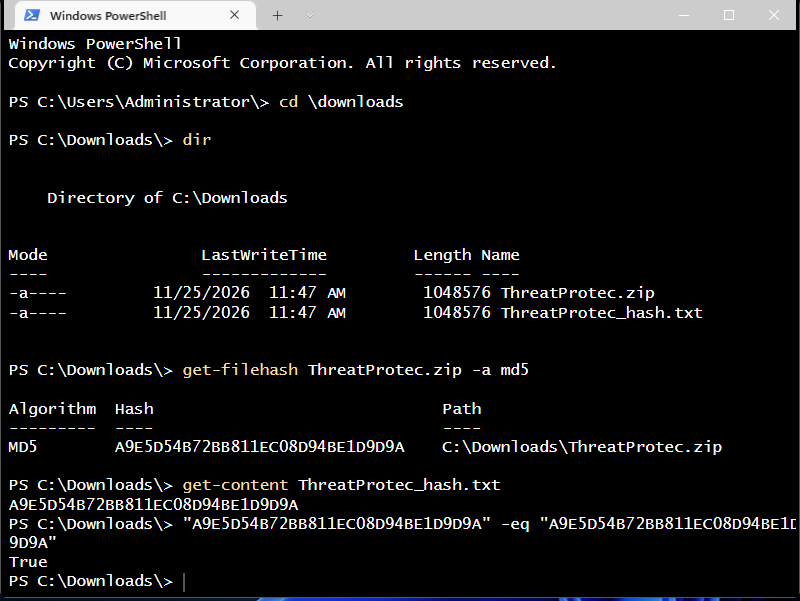

# Compare an MD5 Hash

## Summary

A CompTIA Security+ course lab (3.1.7, Compare an MD5 Hash) in a simulated environment. Acting as the security analyst for a small corporate network, I verified that a newly downloaded release of ThreatProtec.zip had not been altered, using the vendor-supplied ThreatProtec_hash.txt file as the known-good MD5 hash. Both files were in C:\Downloads.

In Windows PowerShell I changed to that folder, listed the files, calculated an MD5 hash of the zip with Get-FileHash, printed the published hash with Get-Content, and compared the two values with -eq. Both hashes were `A9E5D54B72BB811EC08D94BE1D9D9A`, the comparison returned True, and I concluded the file was unaltered.

## My Role

I completed this hands-on in CompTIA's lab on November 25, 2026. I used Windows PowerShell to generate a fresh MD5 hash of ThreatProtec.zip, read the hash the vendor published in ThreatProtec_hash.txt, and compared the two strings. The lab uses standard directory and file names, without a leading `.\`. ThreatProtec and these files are part of the course lab, not a real workplace or my own network. The write-up is my own.

## Key Findings

- `Get-FileHash` calculates a new hash of the file as it is now. It defaults to SHA256 unless you set the algorithm with `-Algorithm` or the short form `-a`, as in `-a md5`.
- `Get-Content` does not calculate a hash. It only prints the text stored in a file. ThreatProtec_hash.txt happens to contain the vendor's published known-good hash.
- When the calculated hash matches the published hash, the file has not been changed. That is a check of integrity.
- Changing even one byte of the file produces a completely different hash.
- MD5 is acceptable for detecting accidental changes or corruption, but it is weak against deliberate collision attacks, so SHA256 is the better choice when you can use it.

## Evidence

### Full PowerShell run

From `C:\Downloads` I ran the commands below. `dir` listed ThreatProtec.zip and ThreatProtec_hash.txt. `Get-FileHash` returned MD5 `A9E5D54B72BB811EC08D94BE1D9D9A` for the zip. `Get-Content` printed the same value from the vendor file. The `-eq` comparison returned True, so the zip was unaltered.

```powershell
cd \downloads
dir
get-filehash ThreatProtec.zip -a md5
get-content ThreatProtec_hash.txt
"A9E5D54B72BB811EC08D94BE1D9D9A" -eq "A9E5D54B72BB811EC08D94BE1D9D9A"
```



| Step | Command | Result |
| --- | --- | --- |
| Change directory | `cd \downloads` | Prompt moved to `C:\Downloads` |
| List files | `dir` | ThreatProtec.zip and ThreatProtec_hash.txt |
| Calculate hash | `get-filehash ThreatProtec.zip -a md5` | MD5 `A9E5D54B72BB811EC08D94BE1D9D9A` |
| Read published hash | `get-content ThreatProtec_hash.txt` | `A9E5D54B72BB811EC08D94BE1D9D9A` |
| Compare | `"A9E5D54B72BB811EC08D94BE1D9D9A" -eq "A9E5D54B72BB811EC08D94BE1D9D9A"` | `True` |

## Defensive Takeaways

- Hash a downloaded file yourself and compare that value to the hash the vendor published. Matching hashes mean the file was not altered after the vendor hashed it.
- `Get-Content` only displays stored text. Use `Get-FileHash` when you need to calculate a hash.
- `Get-FileHash` uses SHA256 unless you pass `-Algorithm` or `-a`. If a lab or a vendor specifies MD5, you have to set that algorithm or the values will not match.
- A hash mismatch means the file was changed or corrupted, even if it still looks the same. Do not run it until you have a clean copy.
- Prefer SHA256 over MD5 when you control the algorithm, because MD5 is not collision-resistant.

## Disclaimer

This is a CompTIA Security+ course lab in a simulated environment. ThreatProtec is a fictional program used for training. The screenshot and write-up document my own work in that lab; they do not represent a real production network or employer.
